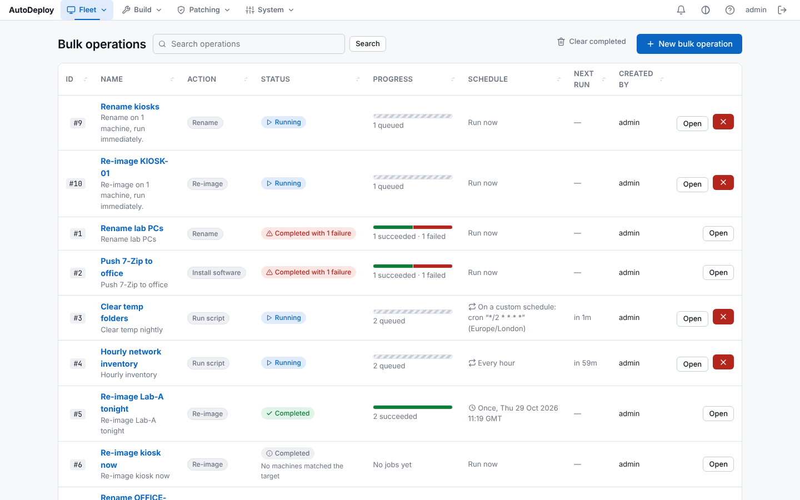
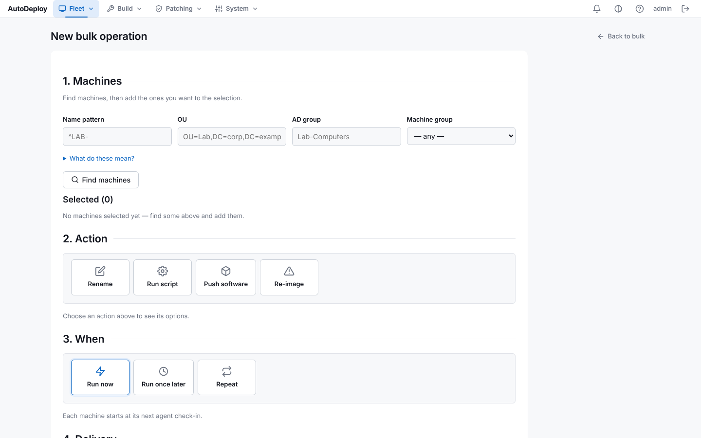
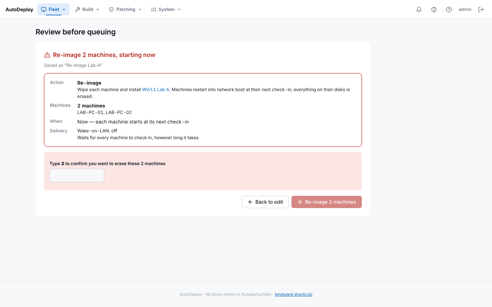

# Bulk operations

Bulk operations let you act on many machines at once: rename a batch, push an app to a department,
run a script across a lab, or re-image a fleet. You search for machines, build a selection, choose
an action, and queue it. Agents pull their job at the next check-in (re-image happens on the next
network boot).

The list shows each operation with its **action**, a **status** in plain words (*Scheduled*,
*Running*, *Completed with 1 failure*, …), a **progress** bar split into succeeded / failed / queued
jobs, its **schedule** and **next run**, and who **created** it. Type in the search box and press
**Search** (or Enter) to find an operation by name; **Clear** removes the search. Click one to track
it.

## Running an operation

Click **New bulk operation** and work through the steps.

### 1. Find machines

Search by **name regex**, **OU** (distinguished name), **AD group**, and/or a
**machine group**, then click **Search**. The filter is a search tool only — the
action runs on the *selection* you build, not on whatever currently matches.

A [machine group](machine-groups.md) can also be the target of a re-evaluated
recurring task (see step 4): choosing **re-evaluate the filter** with a machine
group selected re-resolves that group on every run, so a recurring operation
against a **dynamic** group automatically tracks its live membership.

### 2. Build the selection

From the search results, **Add** the machines you want (or **Add all results**). The selection
panel shows what's queued and lets you remove entries. The action applies to exactly this set.

### 3. Choose an action

Pick the action type; the form reveals only the fields it needs:

| Action | What it does | Extra input |
|--------|--------------|-------------|
| Rename machine | Find/replace (regex) on each machine's current name | **Find** (regex) + **Replace** |
| Run a script | Run a PowerShell or cmd script on each machine | **Shell** + **Body** |
| Push software | Install a package (and its dependencies) on each machine | **Software package** |
| Re-image | Rebuild each machine from an image | **Image** (optional — defaults to each machine's bound image) |

### 4. Choose when it runs

| Schedule | Behaviour |
|----------|-----------|
| **Run now** | Jobs are queued immediately; agents pick them up at their next check-in. |
| **Run once** | Jobs are queued at the date/time you pick (server time). |
| **Recurring** | Re-fires on a preset cadence (hourly / daily / weekly) or a cron expression. A recurring task can either replay the **fixed selection** every run or **re-evaluate the filter** so newly matching machines are picked up. |

### 5. Delivery options

| Option | What it does |
|--------|--------------|
| **Send Wake-on-LAN** | When a run starts, the server broadcasts a magic packet to every targeted machine's known NIC MACs (UDP port 9), so powered-off machines boot and pick the job up. The machine must have reported its hardware inventory at least once (that's where the MACs come from), have WoL enabled in firmware, and be reachable by broadcast from the server. For a re-image this is usually all that's needed: the woken machine network-boots straight into the deploy. |
| **Cancel undelivered jobs after** | A job still waiting this long after its run started is cancelled, and any re-image flag it set is cleared. Use it to fence a scheduled job out of office hours: a re-image queued at 02:00 with *cancel after 5 hours* will never fire on a machine someone first powers on at 09:00 — it boots normally and the job shows as **cancelled**. Blank = wait indefinitely. |

The deadline is enforced server-side, so agents and the boot client respect it no matter when they
appear: an agent checking in after the deadline is never handed the job, and a machine
network-booting after the deadline finds no re-image flag. Both options can be edited on a
scheduled operation until its first run is in flight.

### 6. Review and queue

Click **Review operation**. Nothing is queued yet: the review page describes the operation in
words — for example *"Re-image 2 machines, starting now"* — and lists the machines it will touch
by name, the action's details, when it runs and how it is delivered. Use **Back to edit** to change
anything (your entries are kept), or **Queue operation** to start it.

A **re-image** wipes disks, so its review page also asks you to **type the number of machines** to
confirm; the button stays disabled until the number matches. There is no default action — you must
pick one before the form can be reviewed. If something on the form is wrong (no machines selected,
a recurring task with no filter, …) the form comes back with your entries and the problem marked
next to the field; nothing was queued.

## Tracking results

Open an operation from the list to see its **summary** (action, target, creator, payload) and its
**jobs** — one per targeted machine, each with a **status** (queued / running / ok / failed /
cancelled), when it was claimed and completed, and a result. Results fill in as agents pick up and
report their jobs.

## Notes

- **Rename** does a regex find/replace across names (for example find `^LAB-A-`, replace `LAB-B-`).
  To rename a single machine to a literal name, use the action on that machine's
  [detail page](machines.md#run-an-action-on-this-machine) instead.
- **Re-image** is destructive: each machine reboots on its next check-in, network-boots into
  AutoDeploy, and re-images without operator interaction, so the machines must be configured to
  network-boot.
- Renames coordinate with Active Directory server-side before the local job is queued.
- Creating, editing, pausing, resuming and cancelling an operation are recorded in the
  [activity log](logs.md) under the operator's name; the per-machine results live on the operation's
  [detail page](#tracking-results) and in the `deploy.*` / `bulk.*`
  [notifications](notifications.md).
- Scripts and integrations that POST the bulk form directly (without the review step) still work:
  the review and the typed confirmation are part of the portal's form flow, not of the endpoint.
- Creating an operation fires a `bulk.created` [notification](notifications.md); when its last job
  finishes the matching `bulk.completed` / `bulk.partial` / `bulk.failed` event fires (jobs
  cancelled by the cancel-after window count toward *partial*).
