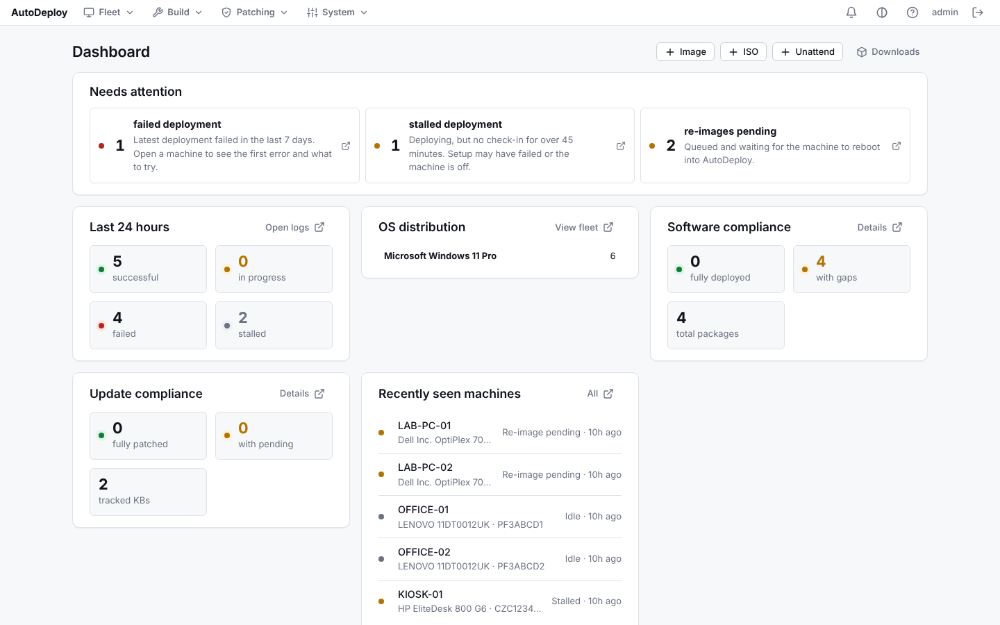
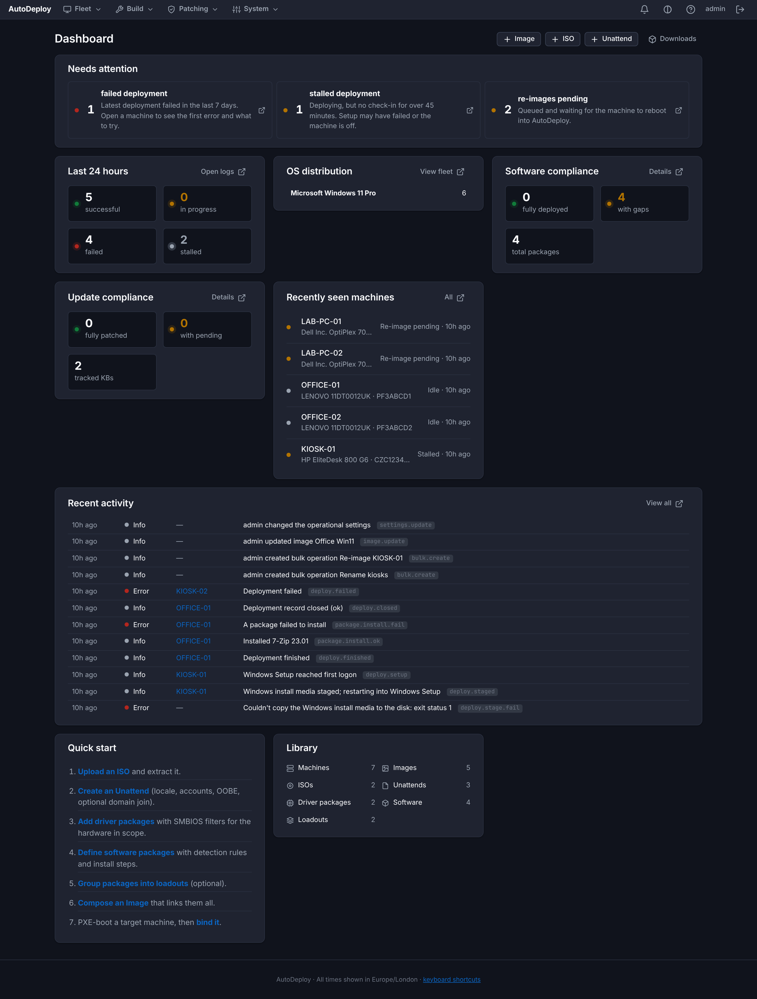

# Dashboard

The dashboard is where you land after signing in. It gives you an at-a-glance view of what's
configured and what's happening across your fleet, plus shortcuts to the things you do most often.

## Finding your way around

The navigation bar groups the portal's pages into four menus:

| Menu | Pages |
|------|-------|
| **Fleet** | Machines, Groups, Bulk operations, Import |
| **Build** | Images, ISOs, Unattends, Drivers, Software, Loadouts |
| **Patching** | Windows Updates, Mirrors |
| **System** | Logs, Settings |

Click a menu (or focus it and press Enter or <kbd>↓</kbd>) to open it; <kbd>↑</kbd>/<kbd>↓</kbd> move
between its pages and <kbd>Esc</kbd> closes it. On a phone the menus fold behind the ☰ button.
Without JavaScript every page link is shown directly. Press <kbd>?</kbd> for keyboard shortcuts.

## Quick actions

Buttons at the top of the dashboard jump into common tasks: new **Image**, new **ISO**, new
**Unattend**, and the **Downloads** page.

## Needs attention

The first panel lists only what needs you: **failed deployments** in the last 7 days, **stalled**
deployments, **re-images pending**, machines whose **AD join** failed or trust broke, ISOs that
failed to prepare, and machines **offline** for more than a week. Each line links to the matching
filtered [machine list](machines.md). When nothing needs attention it says **All clear**.

## Last 24 hours

A rollup of deployment outcomes over the last 24 hours: **successful**, **in progress**,
**failed**, and **stalled** — a deployment that is in progress but has had no agent check-in for
over 45 minutes (the machine may have failed Windows Setup or been powered off). It's a quick health
check — a rising "failed" or "stalled" count is your cue to open the affected machines or the
[activity log](logs.md).

## Software compliance

Shows how many software packages are **fully deployed** (100% of target machines have the package
detected) versus packages **with gaps** (some target machines are missing the package). Click
**Details** to jump to the [software list](software.md) where per-package compliance is broken down.

## Update compliance

Shows fleet-wide Windows Update patch status: how many machines are **fully patched** (every tracked
KB installed), how many have **pending** updates, and the total number of tracked KBs. Click
**Details** to open the [Windows Updates](windows-updates.md) list.

## OS distribution

When machines have reported hardware, a card shows the **OS distribution** across the fleet — each
OS caption (e.g. "Microsoft Windows 10 Pro", "Microsoft Windows 11 Enterprise") with a machine
count. This gives you a quick view of your fleet's OS makeup. Click **View fleet** to jump to the
[machines](machines.md) list.

## Recently seen machines

The machines that have most recently network-booted or had their agent check in — by name, with
their make, model and serial, their status (*Online*, *Deploying*, *Re-image pending*, …) and when
they were last seen. Click one to open its [detail page](machines.md).

## Recent activity

The newest entries from the [activity log](logs.md) — each with its time, level, the machine (by
name) and a plain-English description. For the full, searchable history, open **View all**.

## Quick start

A short checklist links you through the first-run flow: upload an ISO, create an unattend, add
driver packages, define software, group them into loadouts, compose an image, then PXE-boot and
bind a machine.

## Library

How many of each building block you have — **Machines**, **Images**, **ISOs**, **Unattends**,
**Driver packages**, **Software** and **Loadouts** — each linking to its list.

## Light and dark theme

The portal supports both a light and a dark theme. Use the theme toggle (the half-filled circle) at the right of the navigation bar
to switch (it cycles auto / light / dark); the portal remembers your choice.

