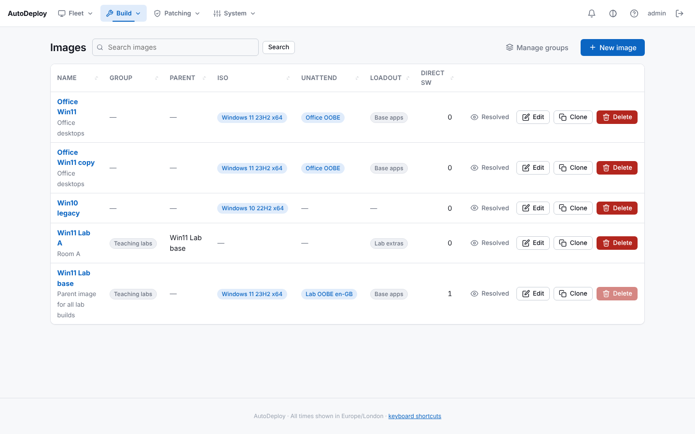
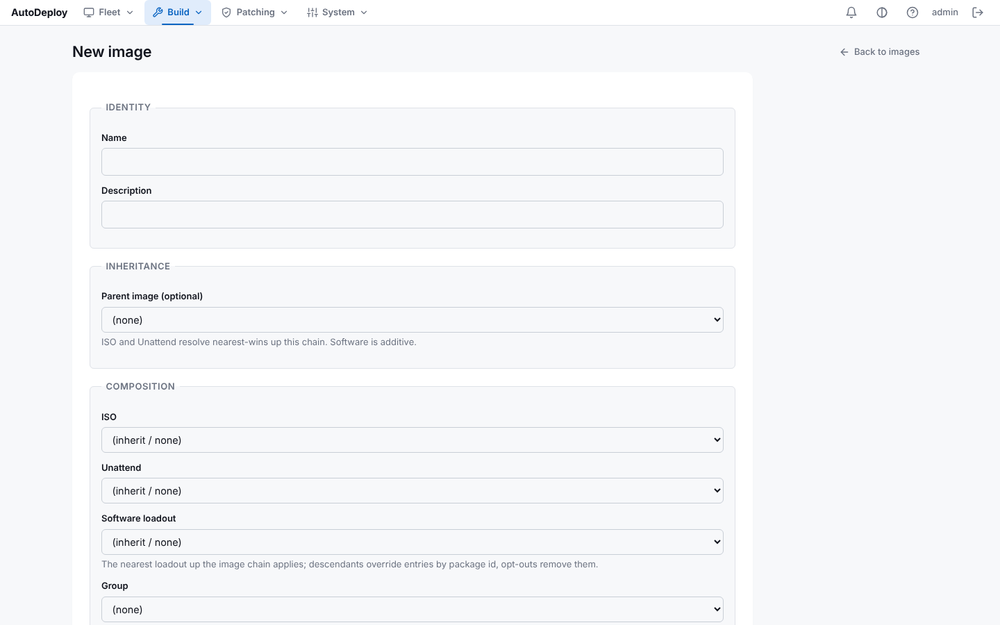
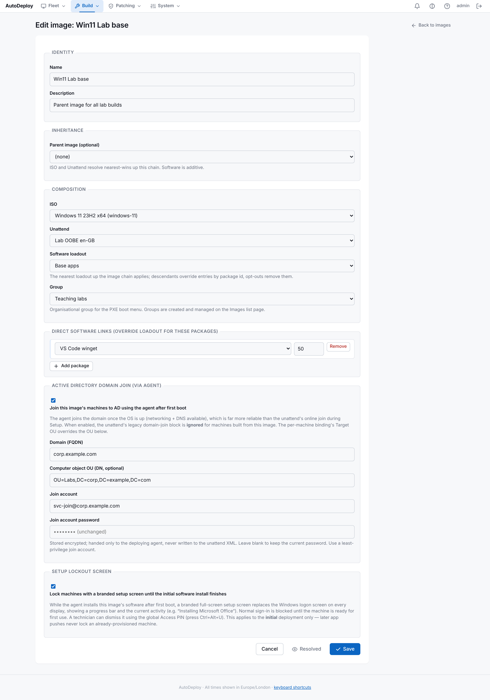
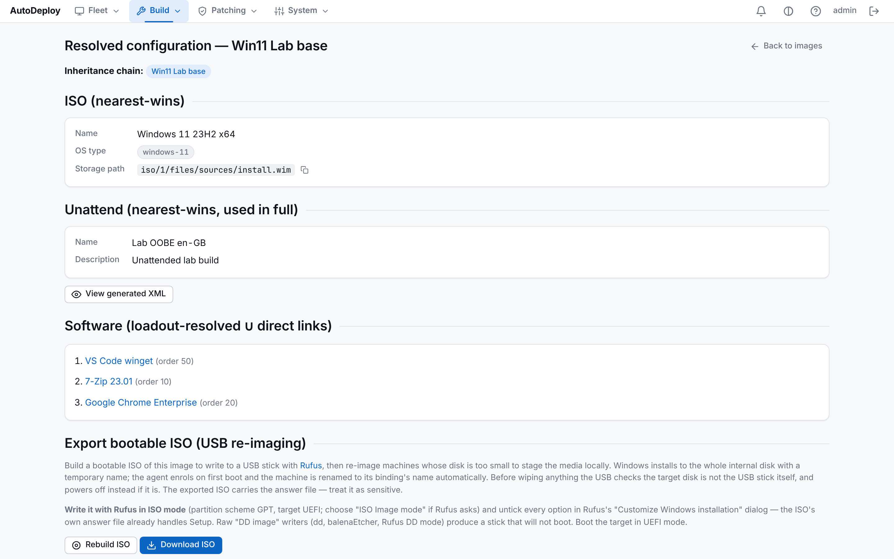

# Images

An **image** is the deployable recipe. It ties together the [payloads](payloads.md) and
[software](software.md) you've prepared into one thing you can deploy: an ISO, optionally an
unattend answer file, a software loadout, driver packages, and any direct software links — with
optional inheritance from a parent image.

When a machine deploys an image, AutoDeploy **resolves** it — works out the exact media, the
drivers that match that machine's hardware, and the flattened software list — and stages the
result.

The list shows each image's **name**, its **parent**, **ISO**, **unattend**, **loadout**, and a
**Direct sw** count of individually linked software packages.

## Composing an image

Go to **Images → New** and assemble the recipe.

| Section | What you pick |
|---------|---------------|
| Identity | Name (required) and description |
| Inheritance | An optional **parent image** — ISO and unattend resolve nearest-wins up the chain; software is additive |
| ISO | The Windows media (or inherit from the parent) |
| Unattend | The answer file (or inherit from the parent) |
| Software loadout | A single [loadout](software.md#loadouts) to install |
| Direct software links | Individual [software packages](software.md) to install, each with an order — these override the loadout for those packages |
| Active Directory domain join | Optionally have the agent join machines from this image to AD — see [below](#active-directory-domain-join) |
| Setup lockout screen | Optionally show a branded full-screen setup screen that blocks sign-in until the first software install finishes — see [below](#setup-lockout-screen) |

Save the image. You can edit it later to change any of these selections.

## Active Directory domain join

The image editor has an **Active Directory domain join (via agent)** section. When enabled, the
[agent](../operations/active-directory.md#agent-driven-join-recommended) joins machines deployed
from this image to the domain **after first boot** — when networking and DNS are fully up, which is
much more reliable than joining during Windows Setup.

| Field | Notes |
|-------|-------|
| Enable | Turn on agent-driven join for this image |
| Domain (FQDN) | e.g. `corp.example.com` |
| Computer object OU | Optional DN; a machine's [binding](machines.md#bindings) Target OU overrides it per machine |
| Join account | A least-privilege account that can join computers |
| Join account password | Stored encrypted; handed only to the deploying agent, **never written into the unattend XML**. Leave blank when editing to keep the current password. |

> When agent-driven join is enabled, any domain-join settings in the image's **unattend are
> ignored** — AutoDeploy drops the unattend join block so Setup doesn't also attempt an online
> join. See [Active Directory](../operations/active-directory.md#domain-join-during-deployment).

## Setup lockout screen

The image editor has a **Setup lockout screen** toggle. When enabled, machines deployed from this
image show a **branded full-screen setup screen in place of the Windows logon screen** on every
display while the agent runs the image's first-boot software install. It shows a progress bar and
the current activity (for example "Installing Microsoft Office"), and normal sign-in is blocked
until the machine is ready for first use.

- The lock applies to the **initial deployment only** — later [software pushes](bulk-operations.md)
  never lock an already-provisioned machine.
- A technician can dismiss the screen early with the global [Access PIN](settings.md#access-pin)
  (press **Ctrl+Alt+U**).
- The screen uses your [branding](settings.md#branding) — product name, organisation, colour and
  logo.
- It's delivered automatically by the agent's bundled credential provider; there is nothing to
  install by hand.

> Drivers are not attached to the image directly — at deploy time AutoDeploy evaluates every
> [driver package's SMBIOS filters](payloads.md#driver-packages) against the target machine and
> stages the ones that match.

> An image deploys usable media only when its resolved ISO's **boot media** is ready — see
> [Payloads → ISOs](payloads.md#isos).

## The Resolved view

Composing an image lists *what you selected*. The **Resolved** view
(`/portal/images/{id}/resolved`) shows *what a deployment will actually apply* once inheritance is
worked out. Use it to sanity-check an image before you deploy.

It shows:

- **Inheritance chain** — the images resolution walks, parent to child.
- **ISO** (nearest-wins up the chain) — name, OS type, and storage path.
- **Unattend** (nearest-wins, used in full) — with a link to view the generated XML.
- **Software** — the de-duplicated list resolved from the loadout (following parent inheritance and
  opt-outs) combined with the image's direct links, in install order.
- **Warnings** — any diagnostics from resolution.

## Deploying an image

There are two ways to get an image onto a machine:

- **From the boot menu** — when a machine network-boots, the operator selects the image on its
  screen.
- **Bind it ahead of time** — open the machine and [bind](machines.md#bindings) it to the image;
  it deploys automatically on the next network boot. You can also re-image many machines at once
  with a [bulk operation](bulk-operations.md).

## Export a bootable ISO (USB re-imaging)

A normal network deploy stages a copy of the whole Windows media set onto a **~7 GiB boot partition
on the target machine's own disk**, then installs Windows into the space in front of it. On a
machine whose disk is too small to hold both, that deploy fails part-way through with an
out-of-space error. For those machines you can instead **export the image as a bootable ISO**, write
it to a USB stick, and boot from the stick — the media lives on the USB, so the whole internal disk
is free for Windows.

Open the image's **[Resolved](#the-resolved-view)** view and use **Export bootable ISO**. The server
builds a bootable ISO of the resolved media in the background (a progress bar shows the stages, and
**Cancel build** stops it); when it finishes, **Download ISO** streams it. The download only ever
serves a *finished* ISO: while a build is running it answers "still building" (HTTP 409), and if no
build has finished yet it says so (HTTP 404) — a failed or cancelled build never leaves a truncated
ISO behind, and a previous good ISO stays downloadable until a new build replaces it. A build that
runs longer than two hours is stopped.

Before it starts, the export checks the image: it needs a linked, prepared ISO, and the unattend's
**Edition** (or the default *Windows 11 Pro* when it is left blank) must be one of the editions
listed on the ISO — otherwise you get an error naming the editions the ISO does contain, instead of
a USB that stops on the target with "no images are available".

**Write the ISO with [Rufus](https://rufus.ie) in ISO mode**: partition scheme **GPT**, target
system **UEFI**, and "ISO Image mode" if Rufus asks. Untick every option in Rufus's *Customize
Windows installation* dialog — the ISO already carries AutoDeploy's answer file. Raw "DD image"
writers (`dd`, balenaEtcher, Rufus's DD mode) do **not** produce a bootable stick: Windows media is
not a hybrid image. Boot the target from the stick **in UEFI mode**.

- The exported ISO installs Windows onto the **whole disk** (a clean install — there is no media
  partition to preserve), so it is only for machines you intend to wipe.
- **It will not wipe the USB stick.** A network deploy boots from the target's own disk, so
  "disk 0" is reliably that disk. From a USB stick it is not: Windows Setup may number the stick
  (or an external drive) as disk 0. So the exported answer file carries no fixed "wipe disk 0" step.
  Instead, before anything is written, a small check on the stick (`\AutoDeploy\diskguard.cmd`, run
  from Setup's first pass) confirms that the target disk (disk 0) exists, is **not** a USB/FireWire disk, does **not** hold the install media, and that the PC
  booted in UEFI mode. Only then does it partition that disk (EFI, MSR, Windows — the same layout as
  before). If any check fails, Setup is stopped, **nothing is wiped**, a message explains why (also
  logged to `X:\Windows\Temp\autodeploy-diskguard.log`), and the PC powers off after five minutes.
  The usual fixes: unplug other USB drives, boot in UEFI mode, or add the PC's storage driver (for
  example Intel RST/VMD) as a driver package so Windows Setup can see the internal disk.
- It bakes in the AutoDeploy **agent** and the image's **boot-critical storage/NIC drivers**; the
  rest of the drivers and all software install after first boot, exactly as in a network deploy.
- **Naming.** The ISO is generic — one file for every machine — so Windows installs with a
  *temporary random name*. On first boot the agent enrols against the server (by hardware identity)
  and the machine is **renamed to its [binding's](machines.md#bindings) computer name** (or the
  image's name template) automatically, then rebooted. If a machine has no binding, it simply keeps
  its random name until you rename it from the portal. So bind the machines (or
  [import an asset list](machines.md)) *before* they check in if you want them named on their own.
- **Requirements.** The server needs `xorriso` installed (see
  [Linux server install](../install/linux-server.md)), and the image's ISO **boot media must be
  ready** — the same readiness a network deploy needs.

> **The exported ISO carries the answer file**, which includes the local administrator / OOBE
> credentials from the image's unattend. Treat exported ISOs as sensitive and don't leave them on
> shared media.

## Next steps

- Set up [network booting](../install/pxe-and-boot.md) so machines can deploy.
- Watch deployments and manage machines in [Machines](machines.md).
