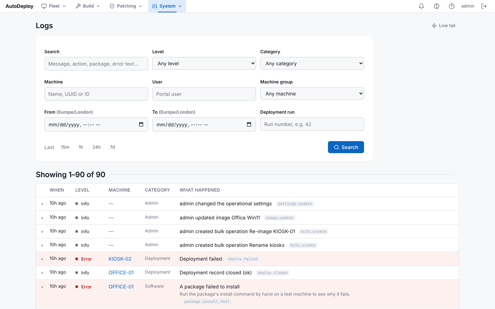

# Activity log

The **Logs** page is AutoDeploy's audit trail: every operator and client action, newest first. Use
it to answer "what happened, when, and who did it" — from an operator editing an image to a Boot
Client staging media on a machine.

## What gets logged

The log captures events from across the system, including:

- **Operator actions** in the portal and API — creating and editing payloads, composing images,
  binding machines, running [bulk operations](bulk-operations.md), changing settings, and so on.
- **Client actions** — the [Boot Client](../introduction.md#boot-client-autodeploy-boot) and
  [agent](../introduction.md#agent-autodeploy-agent) report what they do (identifying, staging
  media, deploying, installing software, reporting results), and those events ship back to the
  server's log.

Each row reads as a sentence: **when** it happened, its **level** (Info / Warning / Error), the
**machine** it belongs to (a link to the machine, by name), a **category** (Deployment, Software,
Updates, Admin, Security, …) and **what happened** in plain English — for example *"Google Chrome
Enterprise failed to install"* rather than a raw event code. The event's code is still shown in
small type beside the sentence, so you can search for it. Failures the portal recognises carry a
**What to try** hint.

Click a row (or focus it and press Enter) to expand it: the details are listed as labelled fields —
package, step, exit code and its meaning, the error text, the last lines the failing command wrote —
with the raw JSON under **Raw** if you need it. Consecutive output lines from one command are folded
into a single block.

Portal changes are written as an audit trail under the operator's name — *"admin updated image
Office Win11"*, *"admin changed the operational settings"* — including saves the portal refused
(*"… — not saved: the form had errors"*) and sign-ins, sign-outs and failed sign-ins.

Rows from older agents and boot clients (which don't send the newer machine/deployment details)
are matched to their machine from the reporting UUID, so they read the same way.

> Secrets are never logged. Retrieving a stored secret (such as a domain-join password) emits a
> `secret.access` event recording the actor and target — but never the value.

## Live tail

A **Live tail** panel streams the newest events matching the current search every few seconds, so
you can watch a deployment unfold without refreshing. Toggle it with the **Live tail** button at the
top of the page.

## Searching and filtering

One search form covers everything, and it runs on the server when you press **Search** (or Enter)
— nothing filters while you type. Every search is a normal page address, so Back / Forward step
through earlier searches and you can bookmark or share one. **Clear** resets it.

| Field | Finds |
|-------|-------|
| **Search** | Text in the message, action code, package name or error |
| **Level** | Errors only, warnings and errors, … |
| **Category** | Deployment, Software, Updates, Admin, Security, … |
| **Machine** | A machine by name, UUID or ID (suggestions as you type) |
| **User** | A portal user's own actions |
| **Machine group** | Events from that [group's](machine-groups.md) member machines |
| **From / To** | A time window, in the portal's display time zone |
| **Deployment run** | Every event of one deployment, by its run number |

The **Last 15m / 1h / 24h / 7d** links set the time window in one click. Results are newest-first
and paged.

The machine page links straight here: **Logs of this run** (the latest deployment) and **All logs
for this machine**. Old bookmarks that used the previous filter names (`component`, `actor`,
`action`, `since`, `limit`) still work — they appear as small removable chips under the form.

## Retention

How long entries are kept is controlled by the log retention setting in
[Settings → Operational](settings.md#operational). A scheduler prunes rows older than the cutoff;
setting retention to 0 disables pruning.

## Related

- A condensed feed of the most recent entries also appears on the [dashboard](dashboard.md).
