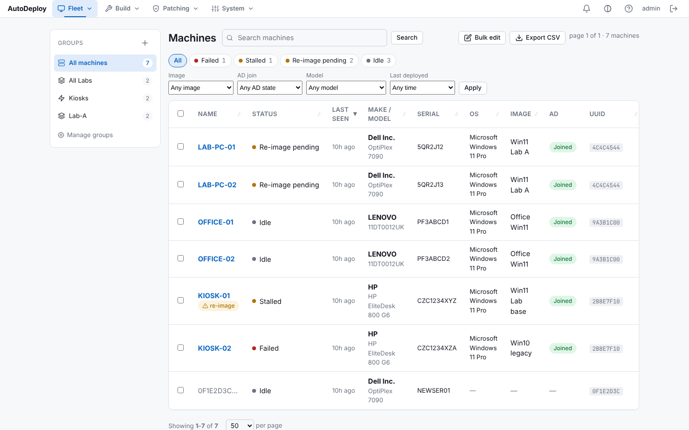
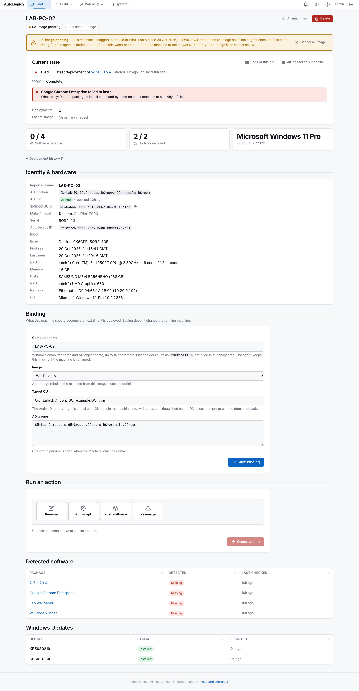

# Machines

The **Machines** page is your inventory: every machine that has network-booted into AutoDeploy or
whose [agent](../introduction.md#agent-autodeploy-agent) has checked in. You don't add machines by
hand — they appear automatically, keyed by their SMBIOS UUID.

## Groups sidebar

Down the left of the page is a list of [machine groups](machine-groups.md), each
with a live member count, above an **All machines** entry. Click a group to
filter the inventory to just its members — the text filter, sorting, paging and
CSV export all stay scoped to it. The **+** creates a group; **Manage groups**
opens the full list. With a **manual** group selected, the checkbox selection
gains **Add to / Remove from** actions so you curate membership from the list.

## The inventory list

The list shows, per machine:

| Column | Notes |
|--------|-------|
| Name | The machine's current computer name (agent-reported, or desired name from binding); a machine that hasn't reported one yet shows the start of its UUID in grey |
| Status | One word for where the machine is: **Online**, **Idle**, **Deploying**, **Stalled**, **Failed**, **Re-image pending**, **Offline** |
| Make / model | Manufacturer and product, from SMBIOS |
| Serial | System serial |
| OS | The running OS (e.g. "Microsoft Windows 10 Pro"), from the agent's hardware report |
| Image | The bound image's name |
| AD | Active Directory join status the agent reports — **Joined**, **Join failed**, or **Trust broken** (hover for detail); a dash means not applicable / not yet reported. See [AD join status & alerts](../operations/active-directory.md#join-status--alerts). |
| Last seen | When the machine last contacted the server |
| UUID | The SMBIOS UUID (truncated; copy the full value from the machine page) |

Type in the **Search machines** box and press **Search** (or Enter) to narrow the list. The search
runs on the server across the whole inventory — names, make/model, base-board identity, serials,
UUIDs, the reported OS and the bound image's name — so the page numbers and totals always describe
what you're looking at. Nothing happens while you type. Each search is its own page address, so the
browser's Back / Forward buttons step through earlier searches and you can bookmark one; **Clear**
removes it. Old bookmarks such as `/portal/machines?q=lab` keep working.

The **status chips** above the list (*Failed 1*, *Re-image pending 2*, *Deploying 1*, *Online 3*,
…) show how many machines are in each state; click one to list just those. The **Image**,
**AD join**, **Model** and **Last deployed** pickers narrow further — choose and click **Apply**
(**Clear filters** resets them). The dashboard's *Needs attention* panel links straight to these
filtered views.

On a phone the list turns into one card per machine with the same fields.

Click a **column header** to sort. Sorting is also server-side, ordering the entire (filtered)
fleet rather than just the visible page; click the active column again to flip the direction.

The pager below the list offers numbered page links and an **items per page** selector
(10–500); your choice is remembered for future visits. You can also select machines with the
checkboxes and **delete** them in bulk — the selection covers the current page.

### Exporting to CSV

Click **Export CSV** to download the inventory as `autodeploy-inventory.csv` for reporting or to feed into
other tools. The export honours the active filter and sort order, so it matches what's on
screen; visit the page unfiltered to export the whole fleet.

## Machine detail

Click a machine to open its detail page, which gathers everything known about it.

At the top, **summary cards** give a quick overview:

- **Software detected** — how many of the machine's targeted packages are detected vs total
- **KBs installed** — how many tracked Windows Updates are installed on this machine
- **OS** — the running OS caption and version
- **Last seen** — when the machine last contacted the server

Below the summary cards, the header shows its SMBIOS UUID, make/model, serial, AutoDeploy ID,
BIOS, baseboard, and first/last-seen times.

### Hardware

Reported by the Boot Client and agent at check-in: **CPU** (with core/thread counts), **memory**,
**disks** (model and size), **GPU**, **network** interfaces (name, MAC, IPs), and the running **OS**
once the agent is up.

### Bindings

A **binding** links a machine to the [image](images.md) it should receive, plus per-machine
identity. In the **Binding** panel you can set:

- **Machine name** — used as the AD object name and the unattend's ComputerName.
- **Bound image** — re-imaging rebuilds the machine to the current definition of this image.
- **Target OU** — the AD organizational unit (distinguished name).
- **AD group memberships** — one per line.

Save it, and the bound image deploys automatically the next time the machine network-boots. Binding
ahead of time is the hands-off path: bind a machine (or a whole set, via a
[bulk re-image](bulk-operations.md)), then boot it and walk away.

### Bulk edit

**Bulk edit** (button on the machine list) applies one binding change to many machines at once:
search by name regex, OU, or AD group, add the machines to a selection, then tick the fields to
change — bound **image** (set or clear), **machine name template**, **target OU**, and **group
memberships** (comma-separated adds and removals that merge with each machine's existing list).
Unticked fields are left exactly as they are on each machine.

Because the same name would collide across machines, the name field takes a *template* —
`LAB-%serial(6)%`, `%random(8)%`, etc. — expanded per machine at deploy/rename time. Like the
single-machine panel, bulk edits change **intended** state: a new OU or name takes effect at the
machine's next deploy, domain join, or rename rather than moving anything immediately. Every bulk
edit is recorded in the [audit log](logs.md).

### Run an action on this machine

The **Run an action** panel queues a single action for this machine (the agent picks it up at its
next check-in, typically within a few minutes):

- **Rename** — rename and reboot.
- **Run a script** — a PowerShell or cmd script.
- **Push software** — install a package (and its dependencies; detection rules skip what's already
  present).
- **Re-image** — rebuild from an image (this machine's bound image, or one you choose). Destructive;
  the machine network-boots and re-images on its next check-in.

The same actions across many machines at once are [bulk operations](bulk-operations.md).

### History and detected software

Further down, the page lists the machine's **deployment history** (start/finish, image, outcome,
notes), its **detected software state** (which packages the agent has found present or absent,
and when last evaluated), and its **Windows Update status** (a table of tracked KBs with their
install status — installed, pending, or failed — and when last reported).

### Removing a machine

The **Delete** action removes a record from inventory (binding, history, and detection state). A
machine that network-boots again simply re-appears.

## Next steps

- Act on many machines at once with [bulk operations](bulk-operations.md).
- Review who did what in the [activity log](logs.md).
