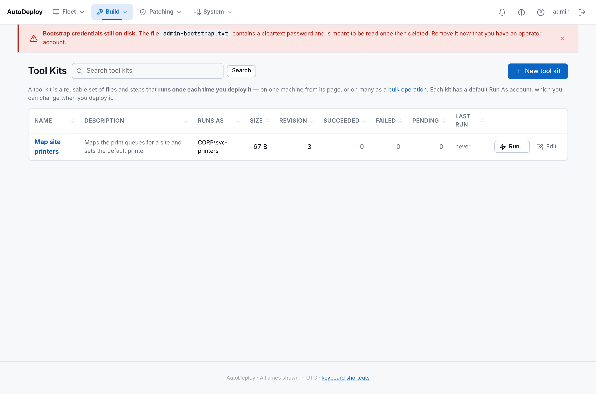
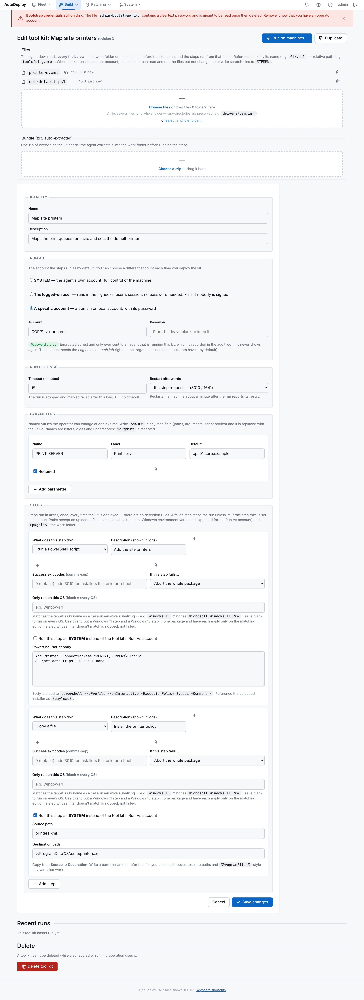
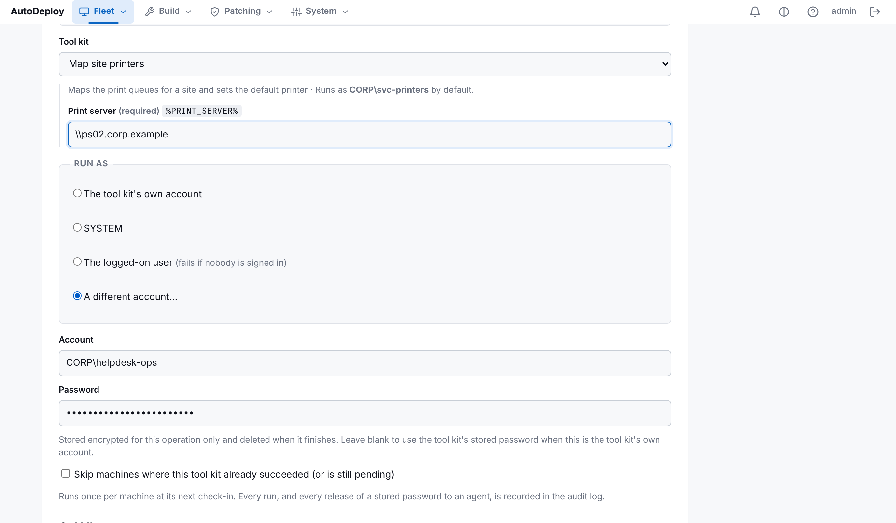
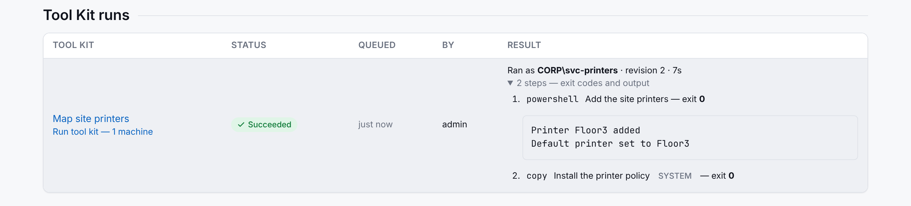

# Tool Kits

A **tool kit** is a reusable set of files and steps that **runs once each time you deploy it**. Use
one for anything you do to machines on demand rather than as part of a build: map a site's
printers, collect diagnostics, reset a stuck component, apply a one-off fix.

A tool kit works like a [software package](software.md), with these differences:

- **No detection rules.** A kit runs every time it is deployed, on every machine you target.
- **Run As account.** A kit runs as **SYSTEM**, as **the signed-in user**, or as **a specific
  domain or local account**. You set a default on the kit and can choose differently each time you
  deploy it.
- **Parameters.** Named values such as `%PRINT_SERVER%` that the operator can change at deploy time.
- **Run controls.** A timeout, a restart policy, and each step's exit code and output reported
  back to the portal.

You deploy a kit to [one machine](machines.md#run-an-action-on-this-machine) from its page, or to
many as a [bulk operation](bulk-operations.md). Bulk operations can run now, once at a set time, or
on a repeating schedule.



The list shows each kit's default account, the size of its files, its current **revision**, and
how many runs have succeeded, failed or are still pending. **Run…** opens a new bulk operation with
the kit already chosen.

## Creating a tool kit

Go to **Build → Tool Kits** and click **New tool kit**. Give it a name, choose its Run As account,
add its steps and save. Then upload any files it needs.



### Files and bundle

Upload files, several files at once, or a whole folder; folder structure is kept. You can also
upload a zip **bundle**, which is extracted before the steps run. The agent downloads everything
into a temporary **work folder** for each run, runs the steps from there, and deletes the folder
afterwards. Reference a file by its name (`fix.ps1`) or its relative path (`tools/diag.exe`).
`%pkgdir%` expands to the work folder. Files are optional, since a script step can do everything
on its own.

### Run As

| Choice | Runs as | Needs |
|--------|---------|-------|
| **SYSTEM** (default) | The agent's own Local System account: full control of the machine. | — |
| **The logged-on user** | The user signed in at the console, inside their session, with their normal (non-elevated) rights. Use it for per-user settings such as `HKCU`, mapped drives, printers and per-user apps. | Someone must be signed in, or the run fails with "nobody is signed in". |
| **A specific account** | A domain (`CORP\svc-tools`, `svc-tools@corp.example`) or local (`.\localadmin`) account. Its profile is loaded, so `HKCU` and `%APPDATA%` are that account's. An administrator account runs **elevated**. | The account's password. The account also needs the *Log on as a batch job* right on the target, which administrators have by default; without it, the agent falls back to an interactive logon. |

The password is **encrypted at rest** and **never shown again**. The edit page only says
*Password stored*. Leave the field blank when saving to keep the stored password. If you change the
account, you must enter the new account's password. If you switch the kit to SYSTEM or the
logged-on user, the stored password is deleted.

**Per-step "Run as SYSTEM".** Each step has a *Run this step as SYSTEM* option. One kit can then
do machine-wide work, such as installing into `Program Files`, and per-user work as its Run As
account. Results mark these steps with a **SYSTEM** badge.

When a kit runs as another account:

- Environment variables in step paths and arguments (`%APPDATA%`, `%USERPROFILE%`, `%TEMP%`) are
  expanded **as that account sees them**.
- The account is given **read and execute** rights on the run's work folder, so it can run the
  kit's files. It can't change them: a kit may also have steps that run as SYSTEM, and those must
  not run files the account could have swapped. Write scratch files and logs to `%TEMP%` instead.
  The agent's work folder is otherwise restricted to SYSTEM and Administrators.
- `copy` and `unzip` steps are carried out by the agent itself, using the account's paths. Their
  files inherit permissions from the destination folder.
- An `appx` step installs the package **for that account**. A SYSTEM run instead provisions it
  machine-wide.

### Run settings

| Setting | Behaviour |
|---------|-----------|
| **Timeout** | The run is stopped after this many minutes, including any child processes a step started, and marked failed with *timed out*. `0` means no timeout. Default: 60 minutes. |
| **Restart afterwards** | **Never** (default), **If a step requests it** (a step exited `3010` or `1641`), or **Always**. The restart happens about a minute after the agent reports the result. A timed-out run never restarts. |

> **Don't restart the machine from a step.** Use **Restart afterwards** instead. If a step restarts
> the machine, for example with `shutdown /r`, the run can't report its result. When the agent
> starts again it reports that run as **failed (interrupted)** and does **not** run it again, so a
> kit that restarts the machine can never cause a restart loop.

### Parameters

Declare a parameter with a **name** (letters, digits and underscores; `pkgdir` and `payload` are
reserved), an optional **label**, a **default**, and whether it is **required**. Write `%NAME%`
(case-insensitive) in any step field, including paths, arguments and script bodies. The server
replaces it with the value before the steps reach the agent. Any `%TOKEN%` that isn't a parameter
is left for the agent to expand as an environment variable.

```text
Parameter: PRINT_SERVER   default \\ps01.corp.example   (required)
Step:      powershell  Add-Printer -ConnectionName "%PRINT_SERVER%\Floor3"
```

### Steps

Steps use the same types as software packages (`copy`, `unzip`, `msi`, `appx`, `exe`, `cmd`,
`powershell`, `winget`), with success codes, *If this step fails…*, and *Only run on this OS*. See
the [install steps reference](../reference/install-steps.md). Steps run **in order**. A failed
step stops the run unless it is set to continue.

### Revisions

Every save, file upload or file removal increases the kit's **revision**. Each run reports the
revision it actually ran. If you edit a kit while operations that use it are still scheduled or
running, the edit page warns you: machines that haven't started yet will run the new revision.

### Duplicate, create from a package, delete

- **Duplicate** copies the kit, including its files, Run As account and stored password, as
  *“name copy”*.
- **Create a tool kit from a software package…**, at the bottom of the list page, copies a
  package's steps and files into a new kit that runs as SYSTEM. The package's detection rules are
  not copied.
- **Delete** is refused while any scheduled, running or paused operation uses the kit. Cancel
  those operations first. Run history stays on each operation.

## Running a tool kit

On the [bulk form](bulk-operations.md) or a [machine's page](machines.md#run-an-action-on-this-machine),
choose **Run tool kit**, then the kit.



- **Parameters.** The kit's parameters appear with their defaults. Change them for this run.
- **Run as.** Choose the kit's own account, **SYSTEM**, **the logged-on user**, or **a different
  account…** (with its password). A password entered here is **stored encrypted for this operation
  only** and **deleted as soon as the operation finishes or is cancelled**. Leave it blank only
  when the account is the kit's own, to reuse the kit's stored password.
- **Skip machines where this tool kit already succeeded** (bulk only). Machines that already ran
  the kit successfully, in any operation, or that still have a run pending are left out. Use it to
  make a recurring or re-evaluated operation run the kit **at most once per machine**.

The review page lists the kit, the account it will run as, and the parameter values. It never
contains the password: the password is held briefly on the server and the page carries only a
reference to it.

## Results

Each run reports which account it ran as, the revision, how long it took, any timeout, restart or
error, and for every step the **exit code** and the **last 4 KB of output** (stdout and stderr
together). You can see results:

- on the **bulk operation's page**, one row per machine;
- in the **Tool Kit runs** section of each **machine's page**;
- under **Recent runs** on the **kit's edit page**.



A finished run also raises a **Tool kit ran** or **Tool kit failed**
[notification](notifications.md) (the `toolkit.run_ok` / `toolkit.run_failed` events).

## Security notes

- A Run As password is released only to the agent of the machine that is **running** that job,
  and only while the job is running. Every release is recorded in the [activity log](logs.md) as
  `secret.access`, naming the kit, the account and the machine, never the password. The agent uses
  the password once to log on and does not keep it.
- Creating, editing, deleting and running kits are all in the activity log under the operator's
  name, as are changes to a kit's stored password.
- **Any portal user can run any kit as its stored account.** AutoDeploy has no per-user
  permissions yet, so give a kit's account only the rights the kit actually needs.
- Running as another account is supported on Windows only. Agents older than this release can't
  run kits and report the job as failed (*unknown action*); agents update themselves on their next
  check-in.

See also: [Security](../operations/security.md#tool-kit-run-as-passwords),
[Bulk operations](bulk-operations.md), and the [install steps reference](../reference/install-steps.md).
